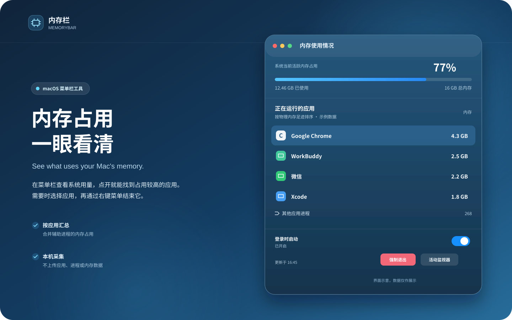

# 内存栏 MemoryBar

[English](README_EN.md)

**内存栏**是一款 macOS 菜单栏内存监视器。菜单栏显示当前内存用量，点击图标可查看占用内存较多的应用，并在需要时结束所选应用或进程。



## 使用方式


## 功能

- 在菜单栏显示系统内存用量。
- 按物理内存足迹统计应用占用，并合并同一应用的辅助进程。
- 默认隐藏占用低于 64 MB 的应用；系统服务不会列入可结束列表。
- 展开查看其他应用进程，选择应用或进程后可从右键菜单或底部按钮结束。
- 可选登录时启动，并可打开 macOS 活动监视器。
- 启动时自动检查 GitHub 最新正式版，也可手动检查；确认后可直接下载并更新应用。
- 所有数据均在本机采集，不上传进程、应用或内存数据。

结束应用或进程可能导致未保存的数据丢失。应用内存统计与“强制退出应用程序”或活动监视器的数值可能不同，原因包括采样时间、物理内存足迹算法和 macOS 对辅助进程的归组方式。

## 下载与安装

从 [Releases](https://github.com/hy123-pixel/MemoryBar/releases) 下载最新的 `MemoryBar-版本号-macOS-universal.zip`，解压后将 `MemoryBar.app` 移到“应用程序”文件夹并打开。

发布包目前未使用 Apple Developer ID 签名或公证。首次打开时，如果 macOS 阻止启动，请在 Finder 中按住 Control 键点按应用，选择“打开”，并在系统提示中确认。

## 系统要求

- macOS 13 或更新版本
- Apple 芯片或 Intel Mac

## 从源码构建

需要 Xcode Command Line Tools 和 Swift 5.9 或更新版本。构建脚本分别编译 Apple 芯片和 Intel 版本，再合并为通用应用：

```sh
git clone https://github.com/hy123-pixel/MemoryBar.git
cd MemoryBar
./scripts/build-app.sh
open build/MemoryBar.app
```

生成可发布的通用 ZIP 包和 SHA-256 校验文件：

```sh
./scripts/package-release.sh
```

输出位于 `dist/`。推送 `v*` 格式的版本标签会触发 GitHub Actions 构建并创建 Release。

## 隐私与权限

内存栏通过 macOS 本地进程接口读取内存信息，无需管理员权限。自动更新会连接 GitHub 查询版本；只有用户选择更新时才会下载应用包，并在安装前核对 SHA-256。不会上传进程、应用或内存数据。macOS 可能限制读取部分进程的信息，因此列表不一定包含所有系统进程。

登录时启动开关使用 macOS“登录项”服务。如果系统要求批准，请前往“系统设置 → 通用 → 登录项”允许“内存栏”。

## 许可证

本项目采用 [MIT License](LICENSE)。
