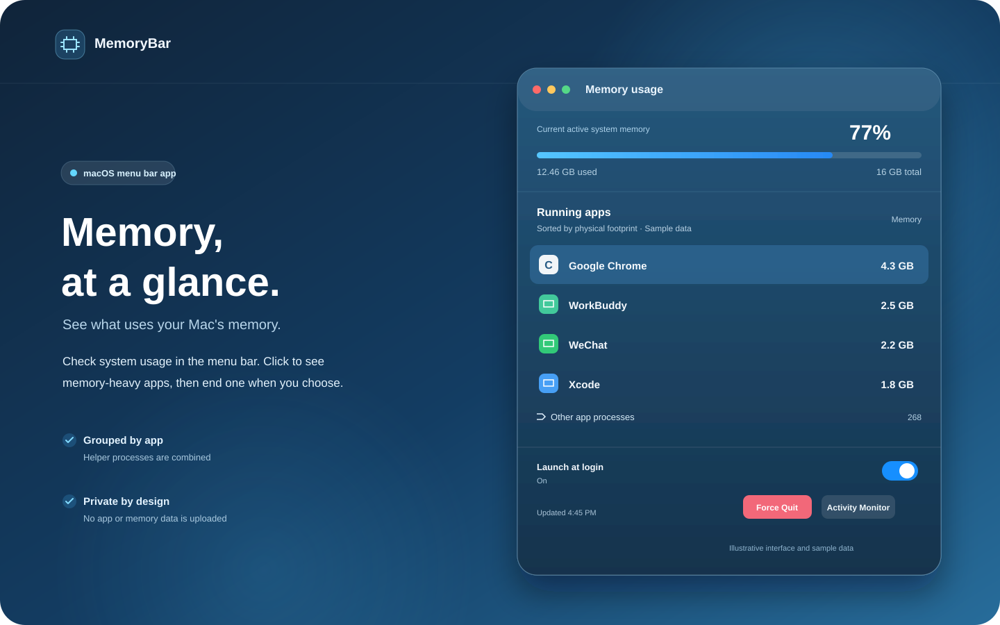
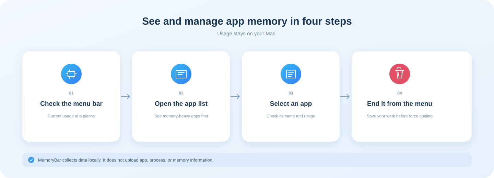

# MemoryBar

[简体中文](README.md)

MemoryBar is a macOS menu bar memory monitor. It shows current memory usage in the menu bar and lists memory-heavy apps when clicked. You can select an app or process and end it from the context menu or the popover.



## How it works



## Features

- Shows system memory usage in the menu bar.
- Measures apps by physical footprint and groups an app's helper processes together.
- Hides apps below 64 MB by default and excludes macOS system services from the termination list.
- Expands to show other app processes; select an item to end it from the context menu or footer.
- Optional launch at login and a shortcut to Activity Monitor.
- Checks GitHub Releases for updates at launch and periodically; users can choose to download and install an update directly.
- Collects data locally; app, process, and memory data are not uploaded.

Ending an app or process can cause unsaved data loss. Memory figures may differ from Force Quit or Activity Monitor because of sampling time, physical-footprint accounting, and how macOS groups helper processes.

## Download and install

Download the latest `MemoryBar-version-macOS-universal.zip` from [Releases](https://github.com/hy123-pixel/MemoryBar/releases), unzip it, move `MemoryBar.app` to Applications, and open it.

Release builds are not signed with an Apple Developer ID or notarized. If macOS blocks the first launch, Control-click the app in Finder, choose **Open**, and confirm the prompt.

## Requirements

- macOS 13 or later
- Apple silicon or Intel Mac

## Build from source

Install Xcode Command Line Tools and Swift 5.9 or later. The build script compiles for Apple silicon and Intel, then combines both binaries into one universal app:

```sh
git clone https://github.com/hy123-pixel/MemoryBar.git
cd MemoryBar
./scripts/build-app.sh
open build/MemoryBar.app
```

Create a distributable universal ZIP and SHA-256 checksum:

```sh
./scripts/package-release.sh
```

Artifacts are written to `dist/`. Pushing a version tag matching `v*` triggers a GitHub Actions build and Release.

## Privacy and permissions

MemoryBar reads memory information through local macOS process APIs and does not require administrator access. Update checks connect to GitHub; an app archive is downloaded only after the user chooses to update, and its SHA-256 checksum is verified before installation. Process, app, and memory data are not uploaded. macOS may restrict access to some processes, so the list may not contain every system process.

The launch-at-login switch uses the macOS Login Items service. If approval is required, allow MemoryBar in **System Settings → General → Login Items**.

## License

MIT. See [LICENSE](LICENSE).
